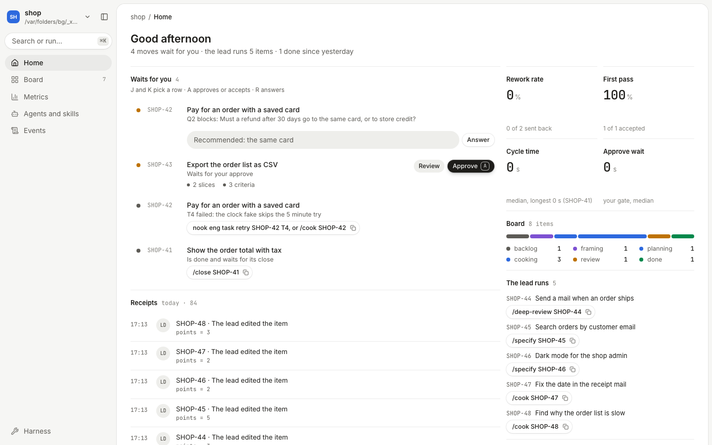
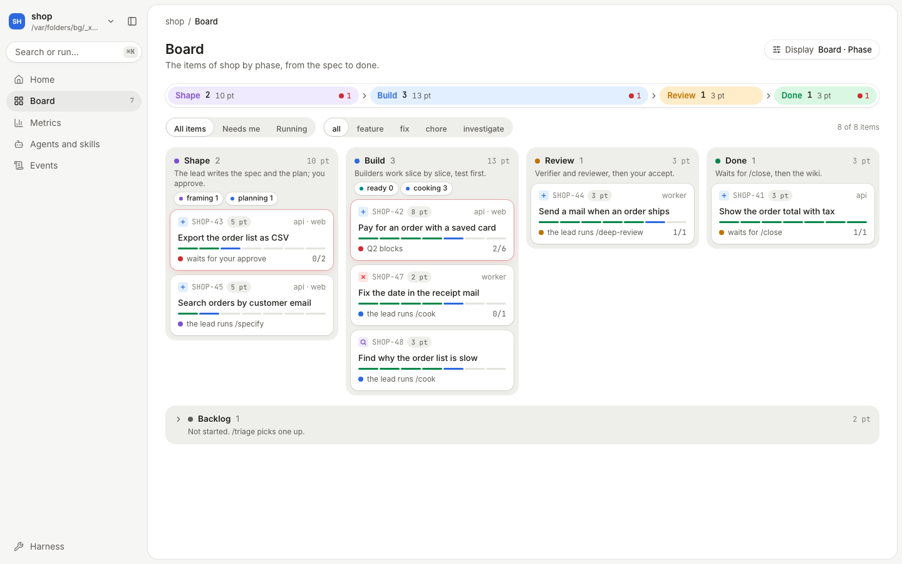

# 3. A day with Nook

> In short: start the day with `/daily-brief`, work with the companion in chat, and decide at the gates. The companion asks only what blocks the work, and brings you in only where a decision is yours.

## Start the day

Type `/daily-brief` in Claude Code, or run `nook brief` in a terminal. The brief reads each workspace of your list and shows three parts:

```
Waits for you
- SHOP-12 waits for your accept: Filter shipments by status → /gate accept SHOP-12
- SHOP-9 is done and waits for its close: Show the carrier name → /close SHOP-9
- a wiki draft waits for your yes: resources/payment-retries.md → read docs/wiki/drafts/resources/payment-retries.md, then say yes or no to the companion

Done since yesterday
- SHOP-7 closed: List shipments page by page

Runs
- SHOP-14 cooking: Retry a failed payment; T2 runs in api → /cook SHOP-14
```

Each gap of `nook doctor` shows on top of the waits. With two workspaces or more, each line names its workspace. Each line names its action. The brief writes no file and runs no action: each line is your choice.

## Work with the companion

The companion is the main session on a workspace. It works as a coworker, a coordinator, an advisor and a consultant.

| It does | Example |
|---|---|
| It answers first, then gives the detail. | "The tests pass: 42 of 42. One proof is weak; here is why." |
| It starts each report with what waits for you. | "Nothing waits for you." or "Your approve waits for SHOP-12." |
| It asks with a choice box, never in prose. | One round of at most four questions, the recommended answer first. |
| It asks only blocking questions. | A wrong guess that costs real work is a question. A small choice is a guess that it reports. |
| It asks for an example when you use an adjective. | You say "make it modern". It asks for one real page and what in it you mean. |
| It says what it did not check. | "I ran the api tests. I did not run the web build." |
| It gives agents the one-shot jobs. | A scout, a verifier, a reviewer. It keeps the whole picture. |

The chat follows your language. Files, code and commit messages are in English.

## Three levels of output

1. **Chat:** the answer in a few lines, and what waits for you.
2. **The Markdown record:** always, in full. Agents read it. Examples: `works/SHOP-12/spec.md`, `docs/wiki/resources/shipments-api.md`.
3. **A page:** only when you ask, when a step calls for it, or when the content has a shape that words hide. `nook web` shows each item as a page. `nook eng item page SHOP-12` writes the same page to `works/SHOP-12/page.html`.

## See your workspaces in the browser

Run `nook web` in your own terminal. It prints the log of Next.js, such as `✓ Ready in 412ms` and one line for each page that the browser opens, and it opens the browser.

| Part | What you see |
|---|---|
| the workspace menu | the top of the sidebar: each of your workspaces with its open items; a click opens that workspace |
| the sidebar | Home, Board, Wiki, Metrics, Agents and skills, Events, and Harness at its foot; a page shows only when its feature is on |
| Home | your inbox: each move that waits for you, acted on in place |
| Board | the items by phase, with a lane that counts them; a click on a card opens it in a drawer |
| Harness | how Nook works here: the features, the agent budget, the secrets, the command lists, the rules and the hooks |
| Metrics | the rework rate, the first pass, the cycle time and the waits at your gates, each with a trend; the root causes and the guard blocks |
| Events | each block of a guard, each error of a hook and each prompt, by day |



In the inbox, you act where you read:

| Row | You do |
|---|---|
| a plan or work at your gate | read its evidence under the title, such as `3 of 4 criteria met · 2 of 2 checks pass`, and its door notes; Review opens the item; Approve or Accept runs the move after a confirm |
| a blocking question | type the answer in the row, then Answer |
| any other move | copy its command, such as `/close SHOP-41` |

J and K pick a row, A runs its gate move, and R puts the cursor in its answer box. ⌘K opens a menu of your moves, the items, the pages and the workspaces. G then B opens the board, and `[` hides the sidebar.



The saved views of the board keep all items, the items that need you, or the items that the lead runs. The Display menu switches between the board and a list, by phase or by who holds the next move. Done and the backlog fold to a strip while nothing in them waits for you.

A card says who moves next with a dot: red when it waits for you. A click opens the item in a drawer with its overview; Open page gives its full page, with a tab for each document. The overview names the agents that worked on the item against your budget, and warns when they pass it.

Any browser on your machine can read the pages. Your moves, such as an approve, need a browser that you paired with `nook web pair`.

## Decide at a gate

Some moves belong only to you. You type them in the prompt; a Nook hook runs the move as the owner.

| You type | It does |
|---|---|
| `/gate` | lists each move that waits for you |
| `/gate approve SHOP-12` | approves the plan; the build can start |
| `/gate accept SHOP-12` | accepts the result; the item is done |
| `/gate mode SHOP-12 yolo` | lets the companion run the next stages alone |
| `/yolo SHOP-12` | sets the mode `yolo` and starts the run |

An agent never runs these moves. The guard blocks a gate move by the model, inside an agent, or in a session that a tool started.

## Keep the workspace healthy

| When | Type | It does |
|---|---|---|
| something feels wrong, or after an update | `/checkup` | runs `nook doctor`, fixes the gaps that are the agent's, lists the gaps that are yours, and tries to read a test secret to prove that the guards run |
| a new repo, or a changed check | `/setup <what changed>` | changes only that part of `nook.yml` |
| the end of a week | `/retro` | finds the items sent back, the guesses flipped, the slow questions and the weak proofs; you pick the change that stops each cause |

`/retro` writes `docs/retro/<date>.md`. `nook retro` prints the same facts with no file. The first retro of a workspace covers the last 7 days.

## Think a big decision through

Type `/grill-me <the decision>`, such as `/grill-me the channel for the first users`. The companion asks one open question at a time and asks for a real example for each adjective. At the end it writes one record: `docs/grill/<date>-<slug>.md`.

Use it for a decision that is already in your head but not in order: a product direction, a channel, a plan.
