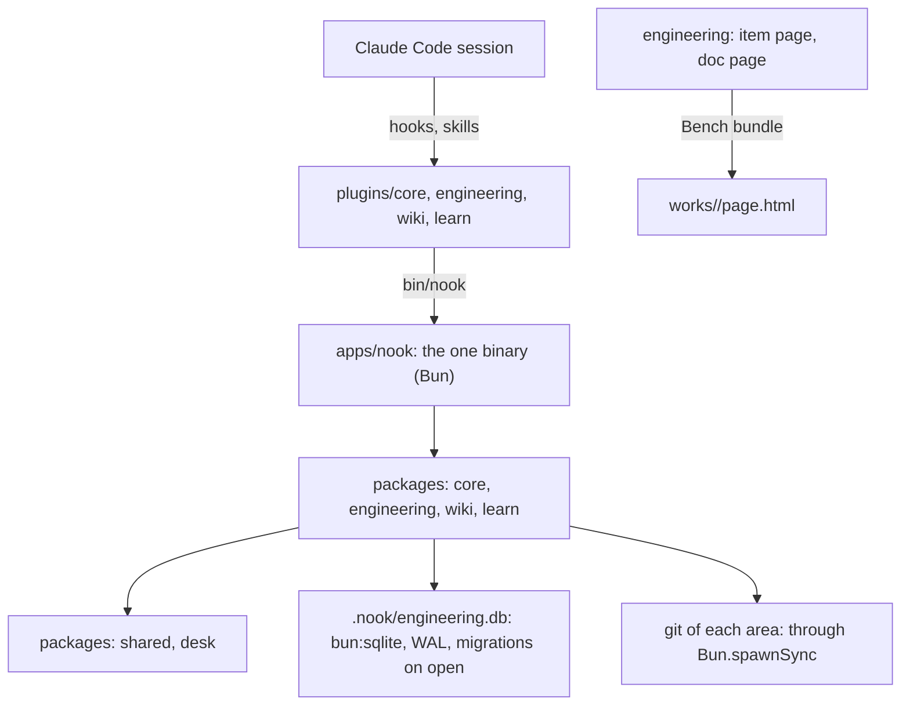
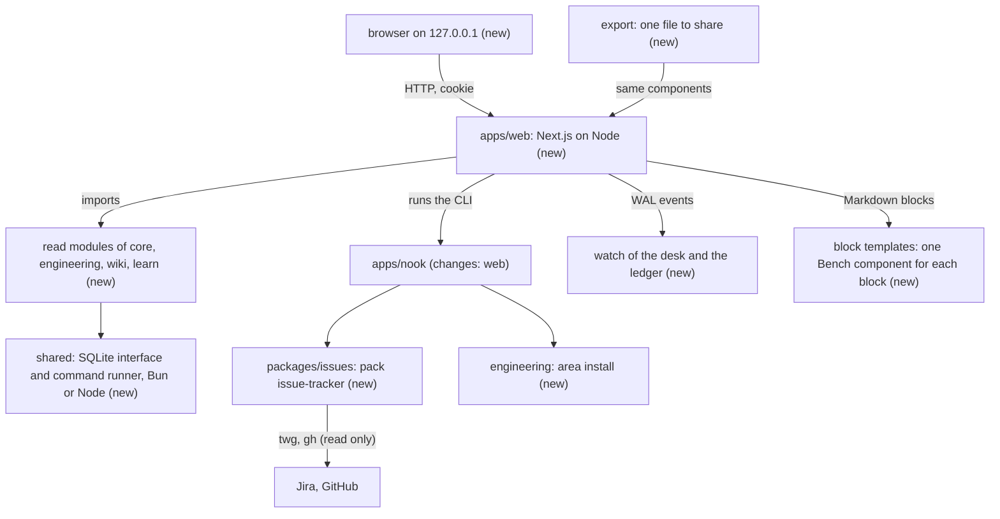
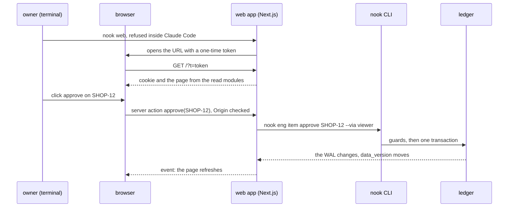

# v0.3: the plan

> In short: four milestones in 21 slices, each milestone merged on its own: the base, the pack issue-tracker, the web app, then the guide. The web app renders every document from Markdown blocks with Bench components; no agent writes HTML. An agent describes a diagram by its structure, and Bench lays it out. The main risk is Next.js on the TypeScript and Bun setup of the repo, so the web app starts with a spike that proves the build before any page.

This plan builds `docs/expect/v0.3.md`. The owner approves it before code. It goes when the release is done.

## Today



- Two Bun APIs sit on a read path: the ledger opens with `bun:sqlite` and runs its migrations in a write, and `brief` and `next` check a ready item with git through `Bun.spawnSync`.
- `engineering.tracker` accepts `jira` and `github`, but no code pulls a ticket. The `install` of an area is read and never run.

## Approach



| Decision | Why | If it fails |
|---|---|---|
| `shared` gets one SQLite file on `node:sqlite` and one command runner on `node:child_process`; Bun and Node both provide them | the ledger and git run from the CLI and from the web app, with one code path | keep two small adapters behind the same interface |
| A read-only open of the ledger: no folder, no migration, `query_only` | a read path never writes; the web app never migrates a ledger | a ledger that needs a migration shows a gap: run any `nook eng` command |
| The read module of each pack is plain functions; `SecretPolicy` moves from core to `desk` | packs may import only `shared` and `desk`; the wiki, learn and engineering reads need the policy | none: core imports it from `desk` |
| The pack issue-tracker is `packages/issues`, with an adapter for each tracker behind the command runner | Jira and GitHub differ only in how they read and map | an adapter that breaks stops only its own source |
| The pull writes to the backlog of the nearest engineering home, read from `nook.yml` through `desk` | one folder for the tickets; the pack never imports engineering | with no engineering home, the pull stops with a gap |
| `nook web` and `nook web pair` refuse to start in a Claude Code session; a pair token exists only in the link that they open or print, and the disk holds only its hash | the owner is the one who can pair a browser; an agent can neither start the app, pair a browser, nor read a token | the port guard and the Origin check stay as defense in depth, never as the control |
| Each page is free to read on its own host; an owner move needs a paired browser | an agent reads the desk files already, so a closed read hides nothing; the moves are what only the owner holds | a page with no pair shows the owner buttons off, with the command that pairs |
| A pair lasts 30 days and stays through a restart; `.nook/web-pairs.json` holds the hash of each session and each open pair token | a restart of `nook web` asks for no new login, and any browser can pair once | `nook web forget` removes each pair |
| The port of a desk stays in `.nook/web.json` after a stop, and the next start takes it again | a bookmark keeps working | when another program holds the port, the start takes a free port and says so |
| `--via viewer` only labels the actor; the role comes from the environment, as today | the server runs in the owner's terminal, so its moves are owner moves; a label cannot raise a role | a move from an agent session stays a lead move and exits 5 |
| A custom server, `server.ts`, holds the gate and checks each request before Next.js | Next.js says not to rely on shared modules or globals in `proxy.ts`, and to check each server action; one gate in front of every request does both | the gate stays a plain function, tested alone |
| One build for each hash of the web and package sources; the desk comes in an environment variable | a build takes a minute; any code change rebuilds | `nook web --build` forces a build |
| The live events follow the `-wal` file of the ledger and `PRAGMA data_version`, plus a watch of the Markdown folders | in WAL mode the main file does not change on a write | the page polls each 2 seconds |
| The web app builds on shadcn/ui: its parts live as code in the package `packages/ui`, styled with Tailwind v4; the Bench tokens fill the shadcn theme variables | the dialog, the tabs and the tooltip come with keyboard and screen reader support; the web app keeps one look with the docs pages | the docs pages of `scripts/pages` keep the Bench CSS |
| Every diagram draws through the Bench diagram library in `plugins/core/ui/bench/` (`diagrams.js`, `diagrams.css`, from the catalog v30); React only wraps it | one design system for each page: the web app, the export and the product docs show the same diagrams | none: no page writes its own drawing code |
| The export renders the same presentational components to one HTML file under Bun, with the compiled CSS and the Bench diagram library inline | Next cannot export pages that use server actions; a file needs no server | the export prints the page with no diagrams and names the part that failed |
| Search is a box of the web app that scans the files through the read modules, with the secret policy | a few thousand files answer in well under a second; no index can go stale | a slow desk gets an index in a later release |
| An agent writes Markdown with blocks (`:::info`, `:::decision`, `- [ ]`, a `bench` fence); `remark-directive` parses them, and each block maps to one React template that uses a Bench component | the agent writes what it writes best, git shows a readable diff, and `nook ste` still checks the words | an unknown block shows as text with a warning |
| The board opens an item in a dialog through an intercepting route; the same URL in a new tab opens the full item page | one page, two views, as in Jira | the dialog links to the full page |
| `nook web` builds into `apps/web/.next/` of the Nook clone, with a stamp of the source hash; git ignores it; one build serves every desk | the pages are code; the content of a desk comes at each request | `nook web --build` builds again |
| The web app needs Node 24 or later; `nook web` checks the version first | Next.js 16 runs on Node; Node 24 is the LTS line and runs `node:sqlite` with no flag; the CLI stays on Bun | `nook web` stops with a gap that names the version and the install |
| An agent writes a diagram as structure: nodes and edges with no grid place; Bench lays out such a graph | most broken arrows and covered labels came from places set by hand | a spec can still set `at` for a hand layout |
| A hook checks each `bench` block of a Markdown file against the schema of its type when an agent writes it | an edge to a missing node or an unknown field comes back at once, as the writing check does for words | the page shows the error and its line |
| `bun run e2e` renders the 22 catalog specs and the diagrams of the docs, and fails on an edge through a node, two labels under 6 px apart, or a label on another edge | a change of the library cannot break a diagram unseen | a failing spec names the diagram and the fault |

| Option not taken | Why not |
|---|---|
| A JSON API between the web app and the packs | a second contract to keep in step, for no gain on one machine |
| A server database, a vector database or a search index | one user and a few thousand files; a scan answers fast enough |
| MDX for the documents | the web app would compile code that an agent wrote |
| HTML pages written by an agent | the owner wants one set of React templates for every page |
| Next.js `output: export` for the shared file | it cannot coexist with server actions |

Dependencies of `apps/web`, each released two weeks ago or more:

| Use | Packages |
|---|---|
| app | `next` 16.3.8, `react` and `react-dom` 19.3.0 |
| documents | `unified` 11.0.5, `remark-parse` 11.0.0, `remark-gfm` 4.0.1, `ts-pattern` 5.9.0 |
| styles | `tailwindcss` and `@tailwindcss/postcss` 4.3.3, `tw-animate-css` 1.4.0 |
| shadcn/ui parts | `radix-ui` 1.6.7, `class-variance-authority` 0.7.1, `clsx` 2.1.1, `tailwind-merge` 3.7.0, `lucide-react` 1.52.0 |
| types | `@types/react` and `@types/react-dom` 19.3.0, `@types/node` 25.9.9, `@types/mdast` 4.0.4 |

The styles and the shadcn parts are dependencies of `packages/ui`; `apps/web` keeps `@tailwindcss/postcss`. The shadcn CLI 4.21.1 runs once through `bunx` to copy a part; it is no dependency. No other package adds a dependency.

## Web app

The web app is one Next.js app in `apps/web/` of this repo. It writes no page to the disk: the server renders each page from the desk files and the ledger when the browser asks for it.

`packages/ui` is the UI base that `apps/web` imports as `@nook/ui/…`:

```text
packages/ui/
├── components.json     the settings of the shadcn CLI
└── src/
    ├── components/     the shadcn parts: button, card, badge, dialog, tabs, tooltip, input, progress
    ├── lib/utils.ts    cn(): the classes of a part joined
    └── styles/globals.css  Tailwind, and the shadcn theme from the Bench tokens
```

```text
apps/web/
├── package.json        next, react, tailwind, radix-ui and the shadcn helpers, unified
├── next.config.ts      transpiles @nook/*, reads the desk from NOOK_DESK
├── tsconfig.json       its own, inside bun run check
├── server.ts           the server of nook web: reads the token from stdin, then the gate, then Next.js
├── app/
│   ├── layout.tsx      the shell: desk name, pack tabs, Bench tokens
│   ├── page.tsx        home: what waits for the owner
│   ├── works/
│   │   ├── page.tsx    the board of items
│   │   ├── layout.tsx  holds the board and the @modal slot
│   │   ├── [id]/
│   │   │   └── page.tsx    the full item page, also in a new tab
│   │   └── @modal/
│   │       └── (.)[id]/
│   │           └── page.tsx    the same item in a dialog over the board
│   ├── wiki/
│   │   └── [...path]/
│   │       └── page.tsx    a shelf index or a page
│   ├── learn/
│   │   └── [course]/
│   │       └── page.tsx    roadmap, cards due, scores
│   ├── search/
│   │   └── page.tsx    results of the search box
│   ├── live/
│   │   └── route.ts    the event stream of changes
│   └── actions.ts      the owner moves: they run the nook CLI
├── components/         presentational: Board, ItemCard, ItemHeader, Criteria, Diagram
│   └── blocks/         one template for each block: Panel, Decision, Expand, Columns, Tasks, Status, Diagram
├── lib/
│   ├── desk.ts         opens the read modules on NOOK_DESK
│   ├── blocks.ts       Markdown with blocks to a block tree
│   ├── search.ts       scans the files of the desk for the search box
│   ├── gate.ts         the host, the pair token, the session cookie, the read and write rule, the Origin check
│   ├── handler.ts      the gate in front of the request handler of Next.js
│   └── cli.ts          runs nook through the command runner of shared
├── export.tsx          renders one page to one HTML file, under Bun
└── .next/              the build of nook web, with its source hash; git ignores it
```

The work splits in five parts:

| Part | Runs on | Job |
|---|---|---|
| Server component | server | reads the desk and renders the markup |
| Client component | browser | diagram, tabs, dialog, gate buttons, search box |
| Server action | server | runs one owner move through the CLI |
| Route handler | server | sends the change events |
| Gate | server | lets a read in on its own host, and an owner move only from a paired browser |

- A page file is a server component. It calls the read module of its pack, such as `readItem(desk, 'SHOP-12')`, and gives the result to the presentational components. The browser gets HTML and no data API.
- A client component starts with `'use client'`. `Diagram` mounts the Bench diagram library on its spec; `Live` opens `/live` and refreshes the page when an event comes.
- A gate button is a form that calls a server action, such as `approve('SHOP-12')`. The action runs `nook eng item approve SHOP-12 --via viewer` and returns the gaps of the guard, word for word.
- A document becomes a page in two steps. `lib/blocks.ts` turns its Markdown into a block tree. `components/blocks/` renders each block with one template, such as `:::warning` with the Bench Alert.
- A click on a card of the board opens `/works/SHOP-12` in the `@modal` slot, as a dialog over the board. A reload or a new tab opens the full page.
- A part that an agent did not write yet, such as a walkthrough, shows an empty panel with the command to type in the agent session.
- The item page has an Overview tab and one tab for each document. A document tab renders only the sections and blocks that its Markdown has. The Overview and the state on the documents come from the ledger.

| Overview part | Source |
|---|---|
| the stepper of the states, and the next step with its owner | the moves of the item |
| Needs you: each open question, each guess to check, the gate; the full lists of questions and guesses | the questions and the guesses |
| the slices on a board by state, with the reason of a blocked or failed slice | the slices |
| the branch of each area, its changed files and lines, its last checks | git through the command runner, and the verify runs |
| the timeline of what happened | the events, each one turned into a sentence |

- A button of Needs you runs the command of an owner move: `nook eng answer`, `nook eng guess accept`, `nook eng guess flip`, `approve`, `accept` and `mode`. The Stop hook of the lead reads a new answer at its next step, so a blocked slice goes on with no restart.
- The web app never writes a desk file or the ledger itself. Each write goes through the CLI and its guards, as a move from `/gate` does.

How one page comes to the screen:

1. The browser asks for `/works/SHOP-12`.
2. The gate of `server.ts` checks the host. A read passes, and the page knows if the browser is paired. A write needs a paired session and the Origin; with no session, the answer is 401.
3. `app/works/[id]/page.tsx` calls `readItem` and `readDocs`. The read modules open the ledger read-only and read `works/SHOP-12/`.
4. The server renders the components to HTML and sends it with the JavaScript of the client components only.
5. `Live` listens on `/live`. A move from any session changes the ledger, and the page refreshes.

How `nook web` starts the app:

1. `nook web` stops with a gap when `CLAUDECODE` is set.
2. It checks that Node 24 or later is on the path. Then it computes the hash of `apps/web/` and the packages. With no build for that hash, it runs `next build` once into `apps/web/.next/`, for about a minute.
3. It takes the port of the last start from `.nook/web.json`, or a free port on `127.0.0.1`.
4. It starts `server.ts` under Node with `NOOK_DESK` set, and keeps the stdin of the server open. The server stops when `nook web` stops.
5. It writes the port and the process to `.nook/web.json`. It makes a one-time pair token, writes its hash to `.nook/web-pairs.json`, and opens `http://127.0.0.1:<port>/?t=<token>`.
6. The gate swaps the token for an HttpOnly cookie of 30 days and drops the token. A second use of the URL gets 401.

`nook web pair` pairs one more browser, such as Safari. It prints a new pair link that works once, within 2 minutes. `nook web forget` removes each pair.

`nook web export /works/SHOP-12 --out shop-12.html` writes the one file to share. It renders the same components under Bun, with the CSS and the Bench library inline, and no server action.

## Impact

| Kind | Impact |
|---|---|
| Contract | new commands `nook issues pull, fields, sources` and `nook web`; documents gain blocks; `nook eng item <move>` takes `--via viewer` as a label; `engineering.tracker` moves to the section `issue-tracker` |
| Data | a ledger migration adds a table of area installs; `.nook/web.json` holds the port and the process; `.nook/web-pairs.json` holds hashes, never a token |
| Security | `nook web` runs only outside Claude Code, on `127.0.0.1`, with a one-time pair token and a cookie of 30 days; a read needs no pair, an owner move needs one; hooks block agent writes through `twg` and `gh`, including `gh api` with a write method; `~/.config/twg` and `~/.config/gh` join the secret files |
| Performance | the first `nook web` builds for about a minute; a search scans the Markdown files of the desk |
| Rollout | each milestone merges on its own, with the reference doc of each new command in the same slice |

None: Cache, Consistency.

## Flow



What must always be true:
- A move from the web app goes through the same guards as a move from `/gate`, and its role comes from the environment.
- No read path writes the ledger, runs a migration or reads a secret file.
- A pair token works once, within 2 minutes. Only `nook web pair` prints one, in the owner's terminal; the disk holds only its hash.
- An owner move runs only from a paired browser.

| Case | What happens |
|---|---|
| a move is refused | the page shows the gaps and their fixes, word for word from the CLI |
| the ledger needs a migration | the page shows the gap and its fix instead of the data |
| `twg` or `gh` has no login | the pull exits 3 with the fix; the desk keeps its tickets |
| the build fails | `nook web` prints the first error lines and starts no server |

## Slices

| Slice | Milestone | Package | Depends | Scenarios | Size |
|---|---|---|---|---|---|
| T1 the SQLite interface and the command runner; the read-only open; git and the ledger move onto them | base | shared, engineering | — | V12 | M |
| T2 `SecretPolicy` moves to `desk`; the secret files of `twg` and `gh` | base | desk, core | — | T15 | S |
| T3 the area install, with its ledger table | base | engineering | T1 | I1–I5 | M |
| T4 the pack: config, `sources`, the plugin, doctor, the move of `engineering.tracker` | issue-tracker | issues, engineering | T2 | T12, T13, T17 | M |
| T5 the GitHub adapter, the ticket file, and `/intake` with the pack | issue-tracker | issues, plugins | T4 | T1, T2, T7–T10, T16 | M |
| T6 the Jira adapter, the field map, the project overrides, and `/setup` with `nook issues fields` | issue-tracker | issues, plugins | T5 | T3–T6, T11 | M |
| T7 the write guard of `twg` and `gh`, with `gh api` | issue-tracker | issues | T4 | T14 | S |
| T8 spike: Next.js builds, type-checks with its own tsconfig, and renders one read module under Node | web | web | T1 | V12 | S |
| T9 the read modules of core, engineering, wiki and learn, with a sentence for each kind of event, the verify runs and the git stats of a branch | web | core, engineering, wiki, learn | T8, T2 | V3–V5, V8, V9, V11, V24 | M |
| T10 `nook web`: the refusal in Claude Code, the build hash, the port, the token, `web.json`, the port guard | web | core, engineering | T8 | V1, V2, V10, V15 | M |
| T11 the shell, the Bench tokens, the presentational components, and one React wrapper of the Bench diagram library | web | web | T8 | — | M |
| T12 the block parser and one template for each block, with the Bench components, the heading rules and mermaid subgraphs | web | web | T11 | V19, V27 | M |
| T13 Bench lays out a graph with no grid places: ranks by the longest path, fewer crossings, a child under its parents, split labels by their targets | web | desk, plugins | T11 | V22 | M |
| T14 the hook that checks each `bench` block against the schema of its type | web | core, plugins | T12 | V21 | S |
| T15 the layout check in `bun run e2e`, over the catalog specs and the diagrams of the docs | web | web | T13 | V23 | S |
| T16 the pages: home, the board with the item dialog, the item, wiki, learn, and the search box | web | web | T9, T12 | V3–V5, V8, V9, V16–V18, S1–S3 | L |
| T17 the live events | web | web | T16 | V7 | S |
| T18 the owner moves with `--via viewer`: approve, accept, mode, answer, accept or flip a guess; the Stop hook of the lead reads a new answer | web | web, engineering | T16, T10 | V6, V25, V26 | M |
| T22 the pairs, the free read, the kept port: `nook web pair` and `forget`, the owner buttons off with no pair | web | core, web | T18 | V1, V2, V28–V30 | M |
| T23 the web app on shadcn/ui and Tailwind: the theme from the Bench tokens, each component on the shadcn parts | web | web | T22 | V31 | L |
| T19 the export | web | web, apps | T23 | V14 | M |
| T20 `/view` gives the link; the page adds What changed, Requirements met and the test counts, so `write-walkthrough` stops writing the first two and writes blocks in its other parts; a walkthrough with no item becomes a draft wiki page; `item page`, `doc page` and their page code go; the Bench UI kit stays | web | engineering, plugins, desk | T19 | V13, V16 | M |
| T21 the guide chapter, the report and the two pages | guide | docs | all | Part 5 | M |

I build the slices one by one on a branch for each milestone, test first, with `bun run check` green after each slice. Each slice updates the reference doc of what it adds. `scripts/pages/` stays: it builds the pages of the product docs, which are not pages of a desk.

## Proof

| Scenarios | Layer | Proof |
|---|---|---|
| T1–T13, T16, T17 | issues, unit and command | the adapters run on recorded `twg` and `gh` JSON through a fake command runner; each map case has its own ticket; the scout case keeps its intake test. Negative: a missing heading never fills Acceptance criteria |
| T14, T15, V10 | desk, core and issues, hook | each blocked command, `gh api -X POST` and `gh api -f` included, has its own test beside a read that passes. Negative: `gh issue view` and `twg jira workitem get` pass |
| I1–I5 | engineering, service | a temporary area with a fake install that writes a stamp. Negative: an unchanged lockfile runs no install |
| S1–S3, V19 | web, unit | a temporary desk with wiki, item and course files and one `.env`; a document with each block kind. Negative: the `.env` text is never found, and an unknown block renders as text |
| V1–V9, V11, V13–V18, V20, V22–V27 | web, end to end | `bun run e2e`, outside `bun run check`: one build, then `nook web` in a temporary desk; the test fetches each page, posts approve, and changes a slice while it listens. Negative: a write with no pair gets 401, and a start with `CLAUDECODE` set is refused |
| V31 | web, unit and end to end | the markup of each component uses the shadcn parts; the theme variables equal the Bench tokens; the dialog and the tabs answer the keys in headless Chrome. Negative: no `bn-` class stays in `apps/web/components` except the diagram |
| V28–V30 | core and web, unit and end to end | the pairs on a temporary desk; the gate on a fake store; the first open and a second browser in headless Chrome. Negative: a used or old pair token fails, and the file holds no token text |
| V12 | shared, both runtimes | the same SQLite and runner tests run under Bun and inside the built web app under Node. Negative: the read-only open refuses a write |
| V21 | core, hook | a `bench` block with an edge to a missing node, one with an unknown field, and one valid block. Negative: the valid block passes |
| V22, V23 | web, end to end | each catalog spec, and a graph with no grid places, renders with no edge through a node and no crowded label. Negative: a spec with a crossing fails the check |

## Risks

| Risk | Likelihood | What we do |
|---|---|---|
| Next.js does not build with the `.ts` imports, the `@nook/*` paths or TypeScript 7 of the repo | med | T8 proves it first; `apps/web` gets its own tsconfig inside `bun run check`, and the Next type check is off |
| The real `twg` JSON differs from the recorded one, such as a description in Atlassian Document Format | med | the adapter converts the document format to Markdown; T3–T6 run on the company desk before the release closes |
| An agent writes a block wrong, such as an unclosed `:::` | med | the parser closes it at the end of the file and the page names the line |
| An automatic layout reads worse than a hand layout for a large graph | med | the spec can set `at` for the nodes that matter; the layout check still runs |
| The release is large and takes several sessions | high | four milestones, each merged and usable; a hand-over note between sessions |

Not done on purpose: writes to a tracker, GitHub Projects fields, a search index, a search by meaning, one web app for two desks.
