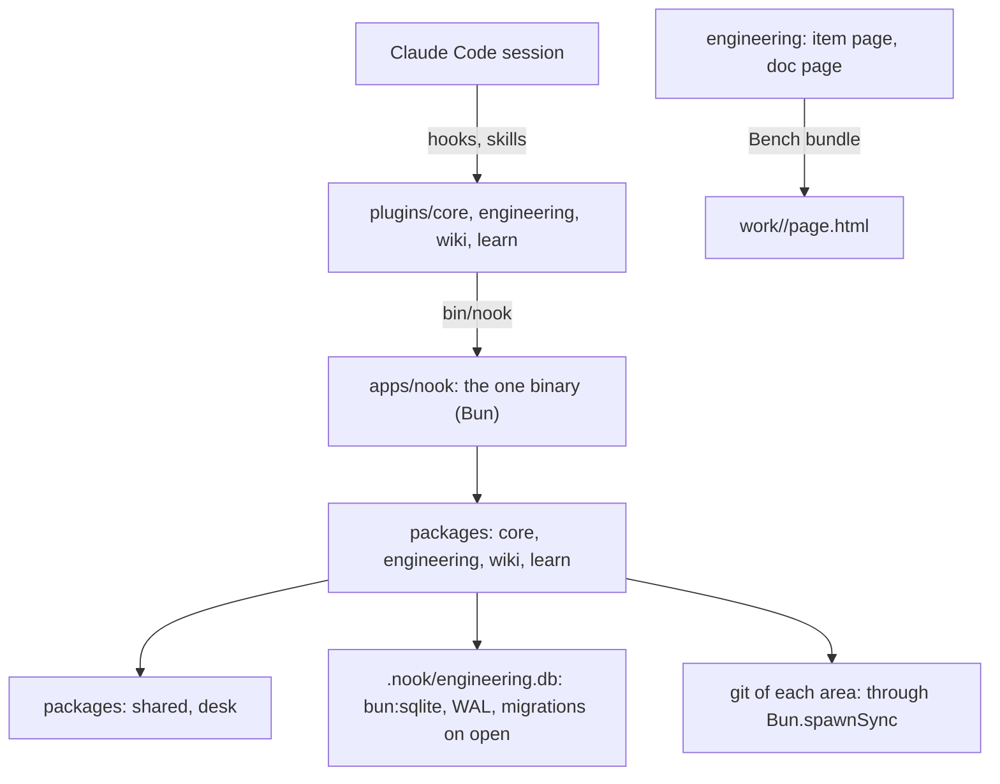
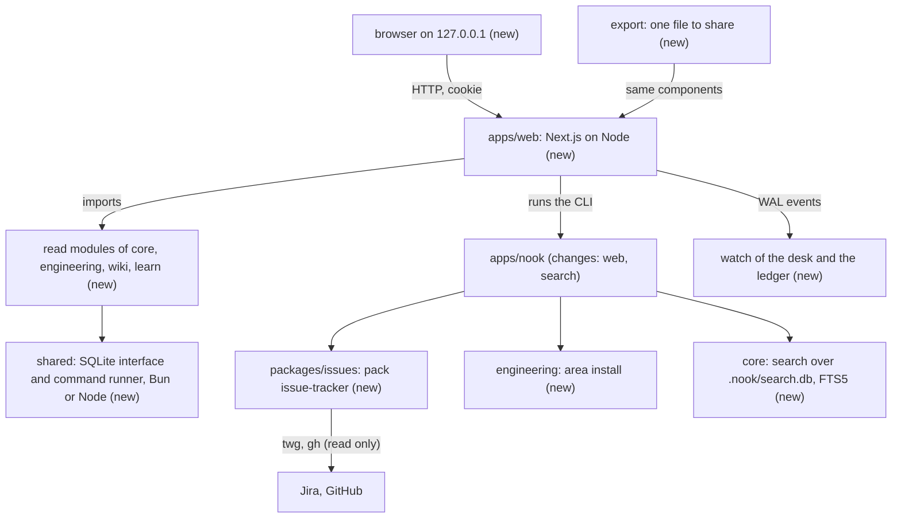
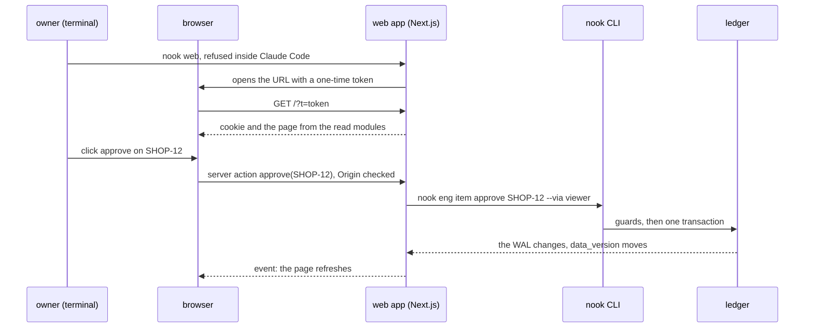

# v0.3: the plan

> In short: four milestones in 18 slices, each milestone merged on its own: the base, the pack issue-tracker, the web app, then the guide. The main risk is Next.js on the TypeScript and Bun setup of the repo, so the web app starts with a spike that proves the build before any page.

This plan builds `docs/expect/v0.3.md`. The owner approves it before code. It goes when the release is done.

## Today

- Two Bun APIs sit on a read path: the ledger opens with `bun:sqlite` and runs its migrations in a write, and `brief` and `next` check a ready item with git through `Bun.spawnSync`.
- `engineering.tracker` accepts `jira` and `github`, but no code pulls a ticket. The `install` of an area is read and never run.
- Checked on 2026-10-17: FTS5 works in `node:sqlite` of Node 24.21 and in `bun:sqlite`.

## Approach

| Decision | Why | If it fails |
|---|---|---|
| `shared` gets one SQLite interface and one command runner, each for Bun and for Node | the ledger, the search and git run from the CLI and from the web app | keep two small adapters behind the same interface |
| A read-only open of the ledger: no folder, no migration, `query_only` | a read path never writes; the web app never migrates a ledger | a ledger that needs a migration shows a gap: run any `nook eng` command |
| The read module of each pack is plain functions; `SecretPolicy` moves from core to `desk` | packs may import only `shared` and `desk`; the wiki, learn and engineering reads need the policy | none: core imports it from `desk` |
| The pack issue-tracker is `packages/issues`, with an adapter for each tracker behind the command runner | Jira and GitHub differ only in how they read and map | an adapter that breaks stops only its own source |
| The pull writes to the backlog of the nearest engineering home, read from `nook.yml` through `desk` | one folder for the tickets; the pack never imports engineering | with no engineering home, the pull stops with a gap |
| `nook web` refuses to start in a Claude Code session; the token exists only in the URL that it opens and in the memory of the server | the owner is the one who can hold the token; an agent can neither start the app nor read the token | the port guard and the Origin check stay as defense in depth, never as the control |
| `--via viewer` only labels the actor; the role comes from the environment, as today | the server runs in the owner's terminal, so its moves are owner moves; a label cannot raise a role | a move from an agent session stays a lead move and exits 5 |
| One build for each hash of the web and package sources; the desk comes in an environment variable | a build takes a minute; any code change rebuilds | `nook web --build` forces a build |
| The live events follow the `-wal` file of the ledger and `PRAGMA data_version`, plus a watch of the Markdown folders | in WAL mode the main file does not change on a write | the page polls each 2 seconds |
| Every diagram draws through the Bench diagram library in `plugins/core/ui/bench/` (`diagrams.js`, `diagrams.css`, from the catalog v30); React only wraps it | one design system for each page: the web app, the export and the product docs show the same diagrams | none: no page writes its own drawing code |
| The export renders the same presentational components to one HTML file under Bun, with the compiled CSS and the Bench diagram library inline | Next cannot export pages that use server actions; a file needs no server | the export prints the page with no diagrams and names the part that failed |
| Search: one index for each desk, at its `.nook/search.db`; each write in `BEGIN IMMEDIATE` with a 5-second busy timeout; deleted files are swept | the CLI and the web app both write it; S3 needs fresh and correct results | `nook search --rebuild` builds it from the files again |

| Option not taken | Why not |
|---|---|
| A JSON API between the web app and the packs | a second contract to keep in step, for no gain on one machine |
| A server database or a vector database | one user and a few thousand rows; SQLite and FTS5 answer in under a millisecond |
| Next.js `output: export` for the shared file | it cannot coexist with server actions |

Dependencies of `apps/web`, each released two weeks ago or more: `next` 16.3.8, `react` and `react-dom` 19.3.0, `zod` 4.6.5, `tailwindcss` and `@tailwindcss/postcss` 4.3.3, `radix-ui` 1.6.7, `recharts` 3.10.1, `react-markdown` 10.1.0, `remark-gfm` 4.0.1, `@types/react` 19.3.0, `@types/node` 25.9.9. No other package adds a dependency.

## Impact

| Kind | Impact |
|---|---|
| Contract | new commands `nook issues pull, fields, sources`, `nook search`, `nook web`; `nook eng item <move>` takes `--via viewer` as a label; `engineering.tracker` moves to the section `issue-tracker` |
| Data | a ledger migration adds a table of area installs; `.nook/search.db` is new and can be rebuilt; `.nook/web.json` holds the port and the process, never the token |
| Security | `nook web` runs only outside Claude Code, on `127.0.0.1`, with a one-time token and a cookie; hooks block agent writes through `twg` and `gh`, including `gh api` with a write method; `~/.config/twg` and `~/.config/gh` join the secret files |
| Performance | the first `nook web` builds for about a minute; a search updates only the changed files |
| Rollout | each milestone merges on its own, with the reference doc of each new command in the same slice |

None: Cache, Consistency.

## Flow

What must always be true:
- A move from the web app goes through the same guards as a move from `/gate`, and its role comes from the environment.
- No read path writes the ledger, runs a migration or reads a secret file.
- The token is never printed, never on the disk, and works once.

| Case | What happens |
|---|---|
| a move is refused | the page shows the gaps and their fixes, word for word from the CLI |
| the ledger needs a migration | the page shows the gap and its fix instead of the data |
| `twg` or `gh` has no login | the pull exits 3 with the fix; the desk keeps its tickets |
| the build fails | `nook web` prints the first error lines and starts no server |

## Slices

| Slice | Milestone | Package | Depends | Scenarios | Size |
|---|---|---|---|---|---|
| T1 the SQLite interface and the command runner; the read-only open; git and the ledger move onto them | base | shared, engineering | — | V12 | M |
| T2 `SecretPolicy` moves to `desk`; the secret files of `twg` and `gh` | base | desk, core | — | T15 | S |
| T3 the area install, with its ledger table | base | engineering | T1 | I1–I5 | M |
| T4 the hook `searchable()`, the index and `nook search` | base | desk, core, wiki, learn, engineering | T1, T2 | S1, S3–S5 | M |
| T5 the pack: config, `sources`, the plugin, doctor, the move of `engineering.tracker` | issue-tracker | issues, engineering | T2 | T12, T13, T17 | M |
| T6 the GitHub adapter, the ticket file, and `/intake` with the pack | issue-tracker | issues, plugins | T5 | T1, T2, T7–T10, T16 | M |
| T7 the Jira adapter, the field map, the project overrides, and `/setup` with `nook issues fields` | issue-tracker | issues, plugins | T6 | T3–T6, T11 | M |
| T8 the write guard of `twg` and `gh`, with `gh api` | issue-tracker | issues | T5 | T14 | S |
| T9 spike: Next.js builds, type-checks with its own tsconfig, and renders one read module under Node | web | web | T1 | V12 | S |
| T10 the read modules of core, engineering, wiki and learn | web | core, engineering, wiki, learn | T9, T2 | V3–V5, V8, V9, V11 | M |
| T11 `nook web`: the refusal in Claude Code, the build hash, the port, the token, `web.json`, the port guard | web | core, engineering | T9 | V1, V2, V10, V15 | M |
| T12 the shell, the Bench tokens, the presentational components, and one React wrapper of the Bench diagram library | web | web | T9 | — | M |
| T13 the pages: home, work, item with the Walkthrough tab, walkthroughs with no item, wiki, learn, search | web | web | T10, T12, T4 | V3–V5, V8, V9, S2 | L |
| T14 the live events | web | web | T13 | V7 | S |
| T15 the owner moves with `--via viewer` | web | web, engineering | T13, T11 | V6 | M |
| T16 the export | web | web, apps | T13 | V14 | M |
| T17 `/view` gives the link; `item page`, `doc page` and their page code go; the Bench UI kit stays | web | engineering, plugins, desk | T16 | V13 | S |
| T18 the guide chapter, the report and the two pages | guide | docs | all | Part 5 | M |

I build the slices one by one on a branch for each milestone, test first, with `bun run check` green after each slice. Each slice updates the reference doc of what it adds. `scripts/pages/` stays: it builds the pages of the product docs, which are not pages of a desk.

## Proof

| Scenarios | Layer | Proof |
|---|---|---|
| T1–T13, T16, T17 | issues, unit and command | the adapters run on recorded `twg` and `gh` JSON through a fake command runner; each map case has its own ticket; the scout case keeps its intake test. Negative: a missing heading never fills Acceptance criteria |
| T14, T15, V10 | desk, core and issues, hook | each blocked command, `gh api -X POST` and `gh api -f` included, has its own test beside a read that passes. Negative: `gh issue view` and `twg jira workitem get` pass |
| I1–I5 | engineering, service | a temporary area with a fake install that writes a stamp. Negative: an unchanged lockfile runs no install |
| S1–S5 | core, unit | a temporary desk with wiki, item and course files, one deleted file and one `.env`. Negative: neither the `.env` text nor the deleted file is found |
| V1–V9, V11, V13–V15 | web, end to end | `bun run e2e`, outside `bun run check`: one build, then `nook web` in a temporary desk; the test fetches each page, posts approve, and changes a slice while it listens. Negative: no cookie gets 401, and a start with `CLAUDECODE` set is refused |
| V12 | shared, both runtimes | the same SQLite and runner tests run under Bun and inside the built web app under Node. Negative: the read-only open refuses a write |

## Risks

| Risk | Likelihood | What we do |
|---|---|---|
| Next.js does not build with the `.ts` imports, the `@nook/*` paths or TypeScript 7 of the repo | med | T9 proves it first; `apps/web` gets its own tsconfig inside `bun run check`, and the Next type check is off |
| The real `twg` JSON differs from the recorded one, such as a description in Atlassian Document Format | med | the adapter converts the document format to Markdown; T3–T6 run on the company desk before the release closes |
| The release is large and takes several sessions | high | four milestones, each merged and usable; a hand-over note between sessions |

Not done on purpose: writes to a tracker, GitHub Projects fields, a search by meaning, one web app for two desks.
