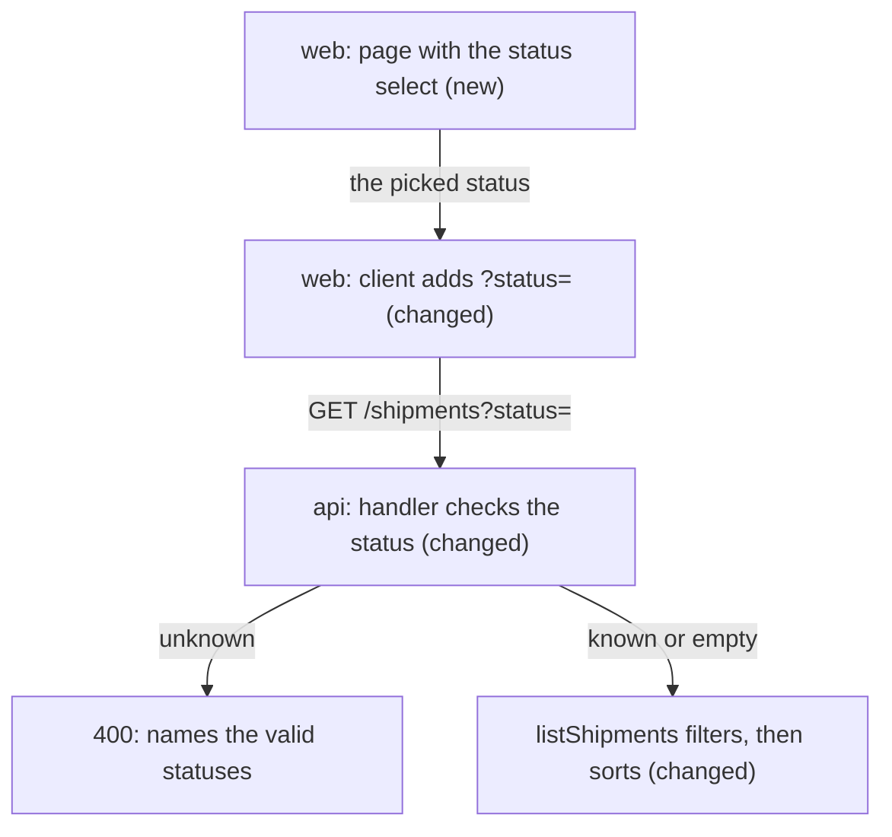

# The sections of plan.md

| Section | Holds | Size |
|---|---|---|
| In short | the approach, the count of slices, the main risk | 2 sentences |
| Today | one mermaid diagram of the parts and calls of today; the facts that the approach rests on | 1 diagram, 3 facts |
| Approach | one mermaid diagram after the change; a table `Decision \| Why` (size L adds `If it fails`); the options not taken with one reason each | 1 diagram, 3 options |
| Impact | one row for each kind that changes; one line "None: ..." for the rest of Contract, Data, Cache, Consistency, Performance, Security, Rollout | the rows that change |
| System design | size L in two places or more: one mermaid flowchart with one `subgraph` for each place | 1 diagram |
| Data model | when the item adds or changes data: one mermaid `erDiagram` of those tables, with PK and FK | 1 diagram |
| Rollout | when the item ships in stages: numbered steps, each with its check | 5 steps |
| Flow | size L only: one mermaid sequence diagram of the hard path; the rules that must always be true; the failure cases | 3 rules, 4 cases |
| Proof | the criteria grouped; for each row the layer, the proof in plain words, and the negative case | 6 rows |
| Risks | what can fail, its likelihood (low, med, high) and what we do; what is left out on purpose; the guesses the plan relies on | 3 rows |

A size M plan stays under 60 lines with text and a size L plan under 100, diagrams included; System design, Data model and Rollout add at most 40. Blank lines do not count.

## The bar for each section
- In short: the owner knows the approach and the main risk after reading it once.
- Today: a reader who does not know the code sees the parts and the calls. A fact names a part, not a line.
- Approach: the owner approves this text. A decision with no reason cannot be approved; a plan that hides the other options hides the risk.
- Impact: a "None" is a claim too. Write it only after you checked that kind.
- Flow: the order of the calls, the transactions and the cache writes, where a wrong order breaks data. Agents cannot start the app, so a timing claim needs a test.
- Proof: the builders write tests first from this section, and the reviewer uses it to decide if a criterion is met. Use the lowest layer that proves it. Mock the edge (network, database, clock), never the code under test.
- Risks: an owner who sees a risk before the build accepts it or changes the plan. "Not done on purpose" is a promise that the reviewer reads.

## The diagrams
Write each diagram as a mermaid block. The record keeps the text; `nook eng item page` shows it as a diagram.

- `flowchart TB` for Today and Approach: it reads well on a phone.
- `sequenceDiagram` for Flow: one participant for each part that takes part in the call.
- `subgraph place["Label"]` … `end` for System design: one group for each place where code runs, in the order that a request crosses them.
- `erDiagram` for Data model: each table with its columns, `PK` and `FK` after the name of a column, and `||--o{` for one to many.
- Mark each part at the end of its label: `(new)`, `(changed)`, `(error)` for an error path, or nothing for a part that stays. Put the area first: `api: vault client (new)`.

## Two snippets
```markdown
## Approach
| Decision | Why |
|---|---|
| One list of statuses in the API | it gives the valid values and the text of the 400, so the two never differ |
| An empty value means no filter (ADR 2) | an All option needs no special value |

| Option not taken | Why not |
|---|---|
| A DOM page with a change handler | nothing serves a page yet, so only a person could check it |
```
```markdown
## Proof
| Criteria | Layer | Proof |
|---|---|---|
| 1, 2, 3 | api, call | `pending` gives the two pending shipments; an empty status gives all four; `lost` and `Pending` give the 400. Negative: `shipped` never gives a pending one |
| 4, 5, 7 | web, page | the select lists All first; opened with no status, the URL is a bare `/shipments`. Negative: no option has the value `all` |
```
Two full plans, of size M and size L: `${CLAUDE_PLUGIN_ROOT}/skills/plan/example.md`.
