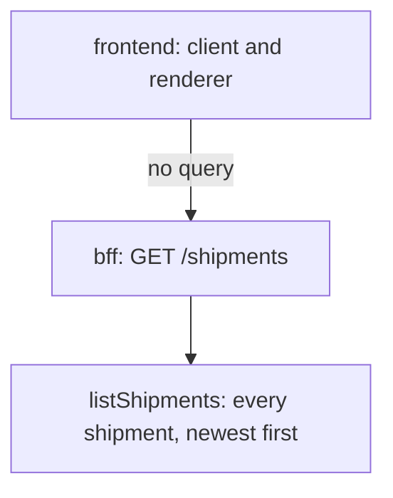
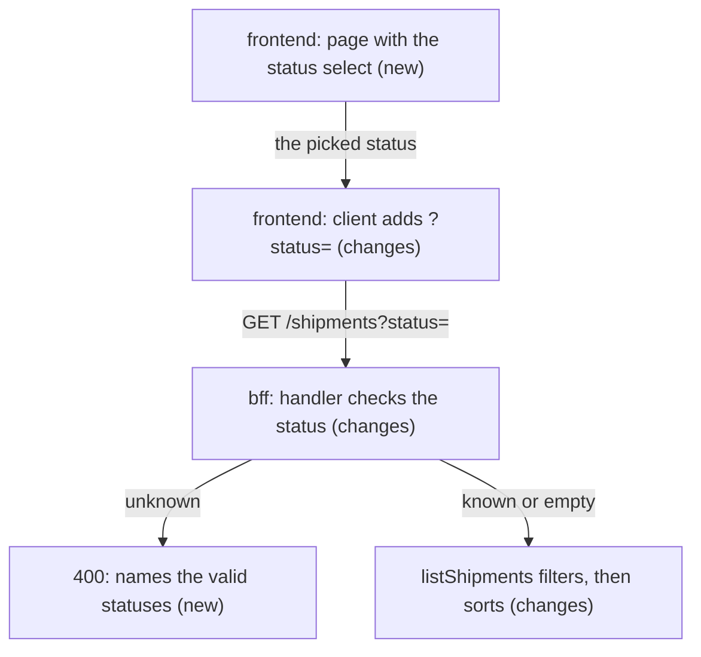
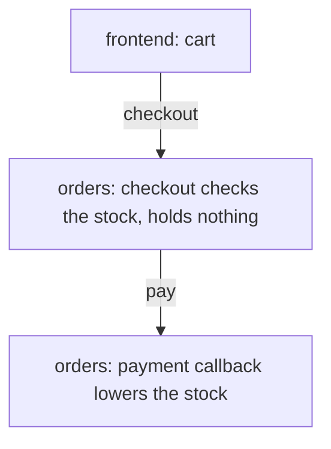
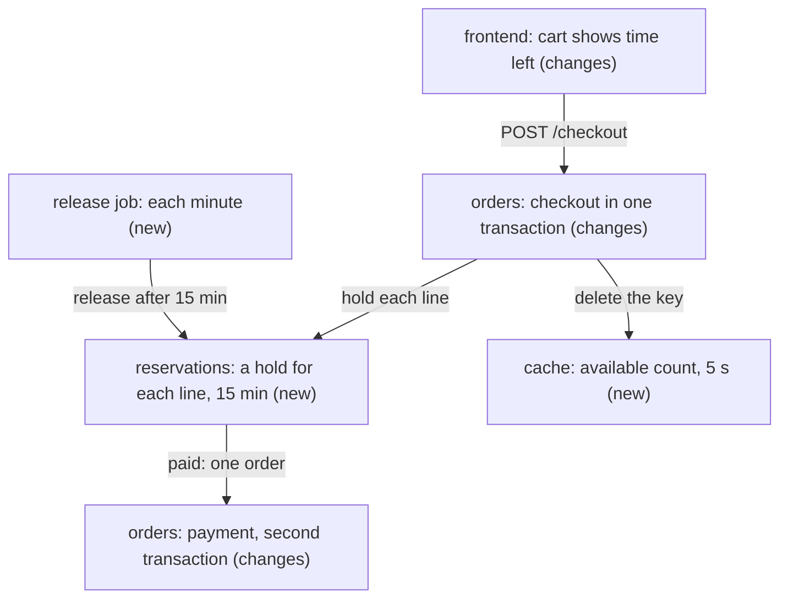
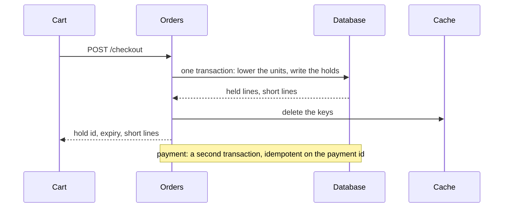

# Two plans and one list of slices

The files that `/recipe` writes. SHOP-12 is size M: no Flow section. SHOP-30 is size L: a table with "If it fails" and a Flow section.
The lanes of the slices are not in `tasks.md`: `kit eng item page` draws them from the ledger.

## SHOP-12: plan.md (size M)

````markdown
---
id: SHOP-12
approach: the bff filters, the page passes the status
created: 2026-10-15
updated: 2026-10-15
---

# SHOP-12: the plan

> In short: an optional `status` query in the bff, and page functions that pass it. 4 slices; the bff ships first. The main risk: the page ships before the bff reads the query.

## Today



- `GET /shipments` returns every shipment, newest first, and reads no query.
- The statuses exist only as a type in the bff.
- The frontend has a client and a renderer, both pure functions, and no page entry.

## Approach



| Decision | Why |
|---|---|
| One list of statuses in the bff | it gives the valid values and the text of the 400, so the two never differ |
| An empty value means no filter (ADR 2) | an All option needs no special value |
| The page stays functions that return HTML (ADR 1) | a test checks each criterion, with no browser and no new dependency |

| Option not taken | Why not |
|---|---|
| A DOM page with a change handler | nothing serves a page yet, so only a person could check it; happy-dom adds a dependency |
| `all` as the value of All | the bff answers it with a 400 |

## Impact

| Kind | Impact |
|---|---|
| Contract | one optional query on `GET /shipments`; additive |
| Security | the status goes into the HTML through the escape of the area |
| Rollout | the bff first, then the frontend; rollback in reverse; nothing is hard to undo |

None: Data, Cache, Consistency, Performance.

## Proof

| Criteria | Layer | Proof |
|---|---|---|
| 1, 2 | bff, call | 1a: `pending` gives the two pending shipments, newest first; 1b: an empty status gives all four; 2: `lost` and `Pending` give the 400 with the exact text. Negative: `shipped` never gives a pending one |
| 3, 4 | frontend, page | the select lists All first; opened with no status or with All, the URL is a bare `/shipments`. Negative: no option has the value `all` |
| 4 | frontend, page | called with `pending`, the URL has the status and the rows are what the bff returns; no match gives "No pending shipments.", with `<b>` escaped. Negative: with no status, the old text stays |
| 5 | frontend, page | a 503 and an unreachable API give the banner text of today. Negative: the text holds no status |

## Risks

| Risk | Likelihood | What we do |
|---|---|---|
| The page ships before the bff reads the query, and filters nothing | low | T4 depends on T2 in the ledger |
| The two status lists drift: the bff and the select | low | three values today; a shared list is a later item |
````

## SHOP-12: tasks.md

````markdown
---
id: SHOP-12
created: 2026-10-15
updated: 2026-10-15
---

# SHOP-12: the slices

> In short: two lanes. T1 and T3 start together. T4 waits for T2 and T3.

## T1: Add the status list and the status filter

- area: bff
- depends: none
- acs: AC1, AC2
- size: S
- files: src/shipments.ts, test/shipments.test.ts
- done when: the filter gives the pending shipments, newest first; the 400 text comes from the list; the 4 tests of today stay green

## T2: Read the status query in GET /shipments

- area: bff
- depends: T1
- acs: AC1, AC2
- size: S
- files: src/handler.ts, test/handler.test.ts
- done when: `pending`, an empty status, `lost` and `Pending` answer as the spec says; the 5 tests of today stay green

## T3: Send the status from the client and name it in the empty text

- area: frontend
- depends: none
- acs: AC4
- size: S
- files: src/client.ts, src/shipment-list.ts, their two test files
- done when: a fetcher that records its URL sees the status, and none for All; the empty text names the status, escaped; "No shipments yet." stays

## T4: Build the shipments page with the status select

- area: frontend
- depends: T2, T3
- acs: AC3, AC4, AC5
- size: S
- files: src/page.ts (new), test/page.test.ts (new)
- done when: the select and the page meet AC3 to AC5, with the exact banner text; `bun test` passes
````

## SHOP-30: plan.md (size L)

````markdown
---
id: SHOP-30
approach: reserve in the database in one transaction; cache the available count for 5 seconds
created: 2026-10-20
updated: 2026-10-21
---

# SHOP-30: the plan

> In short: a reservations table, filled and paid in two transactions, with the available count cached for 5 seconds. 6 slices, behind a flag. The main risk: two carts lock the same products in a different order.

## Today



- Nothing holds stock between checkout and payment.
- The product page reads the stock from the database on each view.

## Approach



| Decision | Why | If it fails |
|---|---|---|
| The holds live in a `reservations` table, not in the cache | a lost cache key sells a unit twice | a slow insert shows in the checkout time; an index on the product keeps it short |
| A conditional update reserves each line; all lines commit in one transaction | a read, then a write, lets two checkouts pass for the last unit | two carts can deadlock: the lines lock in product order, and a checkout retries once |
| An expired hold never counts; a job releases it each minute | the count stays right when the job runs late | a stopped job leaves rows, and the count ignores them |
| The available count is cached for 5 seconds; each write deletes the key | the product page reads it on each view, and the spec allows 5 seconds | a missed delete shows a count up to 5 seconds old |
| The payment id is the key of the payment transaction | providers send the same callback more than once | a second callback changes nothing |

| Option not taken | Why not |
|---|---|
| Holds in the cache only | a lost key sells a unit twice |
| Lower the stock at checkout, raise it on expiry | a crash between the two leaves the stock wrong |

## Impact

| Kind | Impact |
|---|---|
| Contract | `POST /checkout` returns the hold id and its expiry; additive |
| Data | a new `reservations` table and an index; no backfill |
| Cache | one key for each product, 5 seconds, deleted on each write |
| Consistency | two transactions, checkout and payment; the callback is idempotent |
| Performance | one conditional update for each line at checkout |
| Rollout | the flag `reserve_stock`: staging, then 10% of carts, then all; rollback: the flag off, and the table stays unused |

None: Security.

## Flow



- The available units of a product are never below zero.
- A paid hold becomes exactly one order line.
- An expired hold never counts against the stock.

| Case | What happens |
|---|---|
| Two checkouts for the last unit | one commits; the other sees "Only 0 left" |
| A deadlock between two carts | the checkout retries once, then asks the person to try again |
| A payment after the release | the payment finds no hold and fails; the person checks out again (G1) |

## Proof

| Criteria | Layer | Proof |
|---|---|---|
| 1, 3 | orders, service | a checkout writes one hold for each line; a hold older than 15 minutes no longer counts, with and without the job. Negative: a held unit never shows as available |
| 2 | orders, integration | 20 checkouts at once for 1 unit: exactly 1 hold and 19 answers "Only 0 left" |
| 4, 5 | orders, integration | a failure inside the payment step leaves no order and the stock unchanged; the same callback twice gives one order |
| 6 | orders, service | after a hold, the next read of the count is a cache miss. Negative: checkout never reads the cache |
| 7, 8 | frontend, component | the cart shows the minutes left; a short line shows its count, and the other lines show as held |
| always | orders, property | random checkouts, releases and payments never take a count below zero |

## Risks

| Risk | Likelihood | What we do |
|---|---|---|
| Deadlocks under load | med | lock in product order, retry once, watch the deadlock count |
| A slow payment pays after the release | med | G1: it fails, and the person checks out again |
| The product page shows a count up to 5 seconds old | high, by design | the spec allows it; checkout never reads the cache |
````
