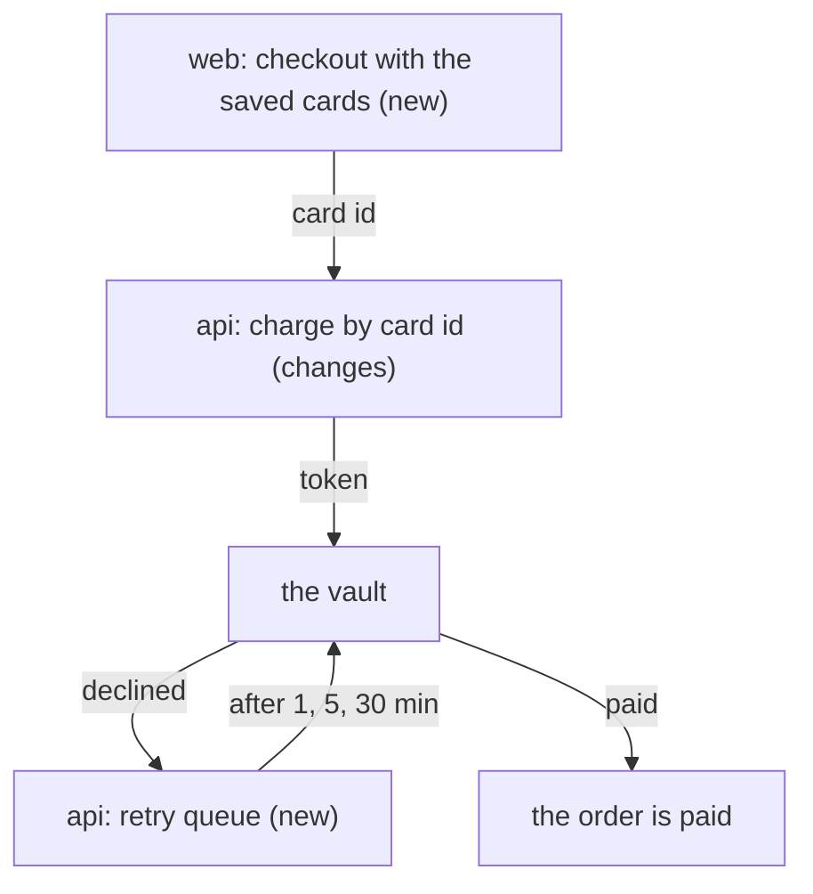

# SHOP-42: the plan

> In short: the api charges a saved card by its id through the vault, and the web shows the saved cards at checkout. The risk is a double charge on a retry.

## Today

The checkout sends the card number to the api on each order. The api charges it once and forgets it.

## Approach

| Decision | Why |
|---|---|
| Keep a token, never the number | the vault holds the number, so the shop stays out of card rules |
| One payment key for each try | a retry or a second click never charges twice |
| Retry from a queue | a slow vault never blocks the checkout |

## Flow

## Impact

| Kind | Impact |
|---|---|
| Data | a new table `saved_card`, with no backfill |
| Contract | `POST /payments` takes `cardId` in place of the number |
| Security | no card number in the shop database |

None: Cache, Consistency, Performance, Rollout.

## Proof

| AC | Layer | Proof |
|---|---|---|
| 1 | api, service | a charge by card id with a fake vault, and a negative with a card of another customer |
| 2 | api, unit | the retry times with a fake clock |
| 3 | api, service | a refund to a removed card |
| 4 | web, unit | the reason of each decline code |

## Risks

A retry that runs twice charges twice. The payment key stops it.
