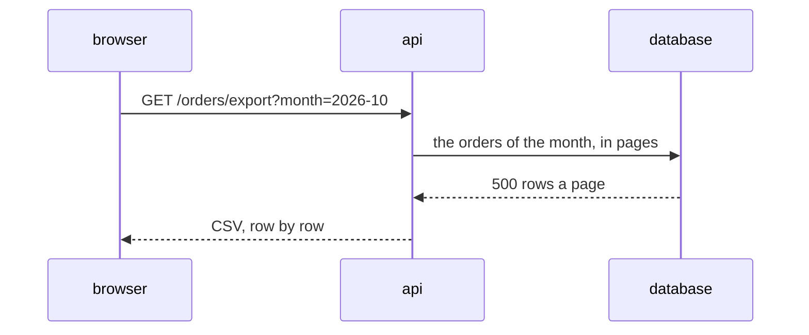

# SHOP-43: the plan

> In short: the api streams the rows of the month, and the web links to the route. The risk is a large month.

## Today

The order list shows 20 orders a page, with no export.

## Approach

| Decision | Why |
|---|---|
| Stream the rows | a busy month holds 5000 orders; the server never holds them all |
| A plain link, no script | the browser downloads the file on its own |

## Flow

## Impact

| Kind | Impact |
|---|---|
| Contract | a new route `GET /orders/export` |
| Performance | one query a page of 500 rows |

None: Data, Cache, Consistency, Security, Rollout.

## Proof

| AC | Layer | Proof |
|---|---|---|
| 1, 3 | api, service | the rows of a month, and a month with no order |
| 2 | web, unit | the link carries the month on screen |

## Risks

A month in another time zone loses the orders of its last hours. G1 covers it.
